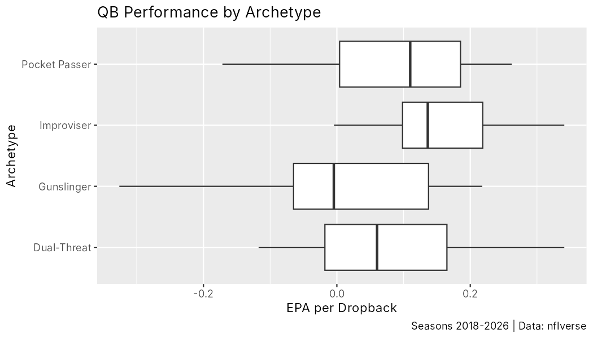
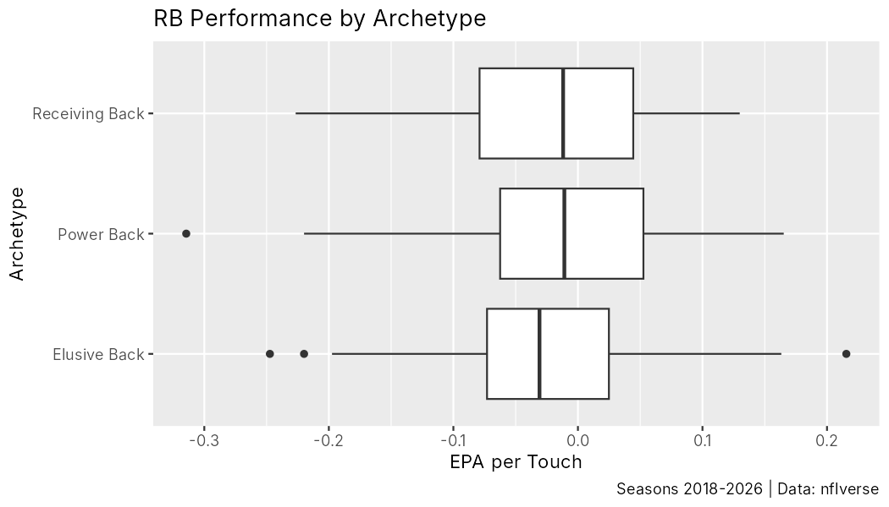
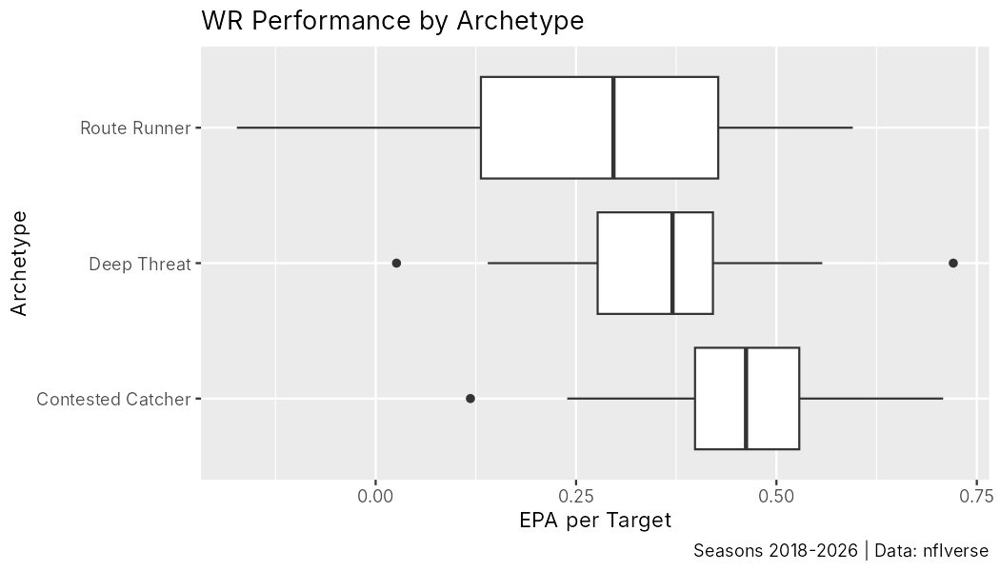

# NFL Player Archetypes

**Which kinds of NFL players produce the most value?** This project sorts quarterbacks, running backs and wide receivers into statistical archetypes using 2018–2026 play-by-play, Next Gen Stats tracking and Pro Football Reference advanced data, then compares how much each archetype contributes in **expected points added (EPA)**.

*Status: archetype definitions and EPA comparisons are complete. Next step: test whether archetype traits are linked to team success (see [Next steps](#next-steps)).*

## How it works

For each position we pick a few measurable traits, standardize them as z-scores across qualifying player-seasons, combine them into an archetype score, and tag the **top 10%** of player-seasons. Every cutoff is calculated within the qualifying pool for that position (for example, WRs with 100+ targets), so each archetype covers the same share of its pool. A player can hold more than one archetype in the same season.

### Quarterbacks (8+ games, 288+ dropbacks where applicable)

| Archetype | Defined by |
|---|---|
| Pocket Passer | Quick time to throw and low scramble rate |
| Gunslinger | High aggressiveness (tight-window throws) and deep intended air yards |
| Improviser | Holds the ball longer, faces more pressure, avoids sacks under pressure, and stays accurate (CPOE, half weight) |
| Dual-Threat | High rush rate and rushing EPA per play, plus yards per carry (half weight). QBs need 100+ pass attempts |

### Running backs (72+ carries)

| Archetype | Defined by |
|---|---|
| Power Back | High share of carries with 7 or fewer yards to go |
| Receiving Back | High share of the team's pass attempts targeted to him |
| Elusive Back | Broken tackles per carry |

### Wide receivers (100+ targets)

| Archetype | Defined by |
|---|---|
| Contested Catcher | High catch rate despite low separation |
| Deep Threat | Highest average intended air yards |
| Route Runner | Most average separation |

## Results so far

**Quarterbacks: EPA per dropback**

| Archetype | QB-seasons | Mean EPA | Median EPA |
|---|---|---|---|
| Improviser | 28 | 0.155 | 0.136 |
| Pocket Passer | 27 | 0.086 | 0.110 |
| Dual-Threat | 28 | 0.083 | 0.060 |
| Gunslinger | 28 | 0.011 | -0.005 |



**Running backs: EPA per touch (carries + targets)**

| Archetype | RB-seasons | Mean EPA | Median EPA | Touch-weighted EPA |
|---|---|---|---|---|
| Power Back | 50 | -0.009 | -0.011 | 0.004 |
| Elusive Back | 50 | -0.021 | -0.031 | -0.025 |
| Receiving Back | 50 | -0.028 | -0.012 | -0.023 |



**Wide receivers: EPA per target**

| Archetype | WR-seasons | Mean EPA | Median EPA | Target-weighted EPA |
|---|---|---|---|---|
| Contested Catcher | 23 | 0.460 | 0.462 | 0.465 |
| Deep Threat | 23 | 0.359 | 0.370 | 0.363 |
| Route Runner | 23 | 0.286 | 0.297 | 0.298 |



Early takeaways (descriptive, not causal):
- **Improviser QBs** produced the most EPA per dropback, and **Gunslingers** the least.
- **Running back archetypes are bunched close to zero**, consistent with the broader finding that RB value depends heavily on the offense around them.
- **Contested Catchers** lead WRs by a wide margin. Part of this is built into the definition: a high catch rate means more completed targets, which raises EPA per target.

The 2026 season is partial and updates as new data is published.

## Run it yourself

Requires R with `nflreadr`, `dplyr` and `ggplot2`. All data is downloaded from the public [nflverse](https://github.com/nflverse) data releases, so no local files are needed.

```r
install.packages(c("nflreadr", "dplyr", "ggplot2"))
```

```bash
Rscript run_all.R
```

This writes player-level archetype tags and EPA summaries to `output/` and the charts to `output/figures/`.

## Repository layout

```
R/00_setup.R            packages, season range, data loads, helpers
R/01_qb_archetypes.R    QB archetypes + EPA per dropback
R/02_rb_archetypes.R    RB archetypes + EPA per touch
R/03_wr_archetypes.R    WR archetypes + EPA per target
run_all.R               runs everything, saves CSVs and charts
output/                 results (CSV) and figures (PNG)
```

## Method notes

- **Next Gen Stats:** the week 0 row (a season total) is dropped, so season averages and games played use weekly data only.
- **Open question:** "Power Back" uses carries with 7 or fewer yards to go, which captures many standard downs, not just short-yardage situations.
- **Open question:** gadget QBs (the "Taysom Hill problem") can still qualify as Dual-Threat if they meet the passing threshold.

## Next steps

- Test whether archetype traits are linked to team success (wins, playoff appearances, offensive EPA).
- Apply the archetypes to individual rosters, for example which archetypes a team has and which it lacks compared with playoff teams.
- Add tight end and defensive archetypes.

## Authors

- **Ashwin Subramaniam**: quarterback and wide receiver archetypes, EPA comparisons ([GitHub](https://github.com/ashwinsubramaniam30))
- **Naveen Narayanaswami**: running back archetypes, first drafts of the deep threat and route runner definitions ([GitHub](https://github.com/naveennar2026-git))

Data: [nflverse](https://github.com/nflverse) via the `nflreadr` R package (play-by-play, Next Gen Stats, Pro Football Reference advanced stats).
